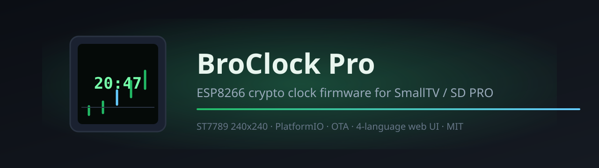
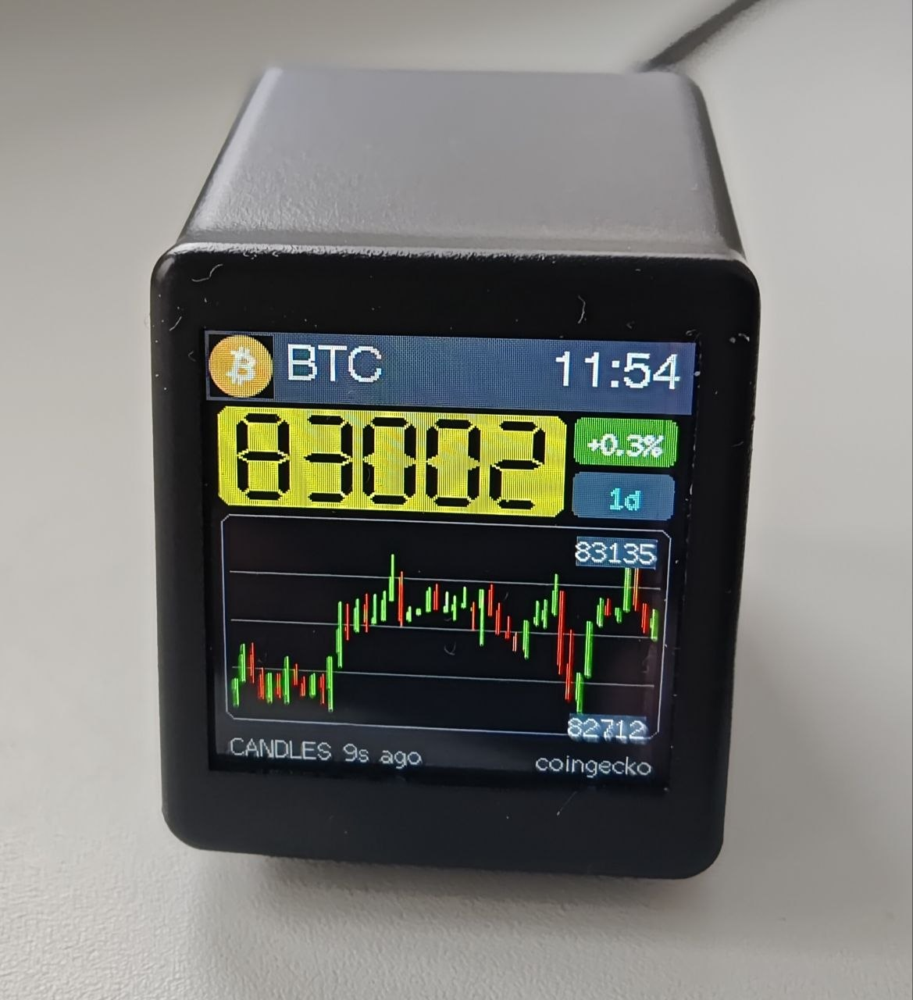
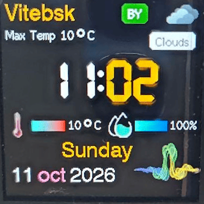

[](https://github.com/sam8ac/BroClock-Pro/releases/latest)
[](LICENSE)
[](https://github.com/sam8ac/BroClock-Pro/actions/workflows/ci.yml)


[](https://github.com/sam8ac/BroClock-Pro/releases)
[](https://github.com/sam8ac/BroClock-Pro/issues)

**RetroTV Pro** (BroClock Pro) — open-source ESP8266 firmware for
**GeekMagic SmallTV / SmallTV-Ultra**-class retro clocks (incl. the SD PRO
board): crypto & weather desk clock with 8 themes, candlestick charts,
carousel, holidays, OTA and a **4-language** web UI.

[Установка / Install](docs/INSTALL.md) · [Hardware](docs/HARDWARE.md) · [HTTP API](docs/HTTP-API.md) · [Releases](https://github.com/sam8ac/BroClock-Pro/releases) · [Issues](https://github.com/sam8ac/BroClock-Pro/issues)

---

Turn the $20 TV-shaped desk clock from a wallpaper gadget into a real
information device: **Bitcoin & altcoin prices with 48-period charts, live
weather in any language, 8 switchable UI themes, holiday calendars,
night-mode backlight and full control from a phone browser** — all on the
stock ESP8266 (ESP-12E) and ST7789 240×240 display. No cloud, no account, MIT
licensed.



*Часы в работе: экран с графиком BTC.*

## 💻 Языки проекта / Project languages

| Часть | Язык | Где |
|---|---|---|
| Прошивка (вся логика, экраны, сеть) | **C++** (Arduino framework, ESP8266) | [`src/main.cpp`](src/main.cpp) + [`src/*.h`](src) |
| Веб-интерфейс (встроен в прошивку, живёт на устройстве) | **HTML + CSS + JavaScript** | raw-строки `PAGE[]`, `SETUP_PAGE[]` в `main.cpp` |
| Инструменты сборки ассетов/шрифтов | **Python + Node.js** | [`tools/`](tools) |
| Сборка | **PlatformIO**, пинованные версии — повторяемый образ | [`platformio.ini`](platformio.ini) |

Веб-интерфейс не тянет ничего из интернета — ни библиотек, ни шрифтов: он
отдаётся прямо с часов и работает в офлайне.

## 🌐 Мультиязычность — 4 языка из коробки

**EN · RU · ES · ZH** — весь интерфейс, включая сообщения об ошибках,
подсказки, всплывающие алерты и статусы. Переключение в веб-UI мгновенное
(без перезагрузки страницы), выбор запоминается на устройстве и синхронизируется
с языком экрана. Заголовки вкладок, настроек и блоков, часы (12/24), алерты
сканера Wi-Fi, ошибки загрузки фото, геолокации и обновлений — все переведены.

## ✨ Все преимущества

### 💰 Криптовалюты
- Каталог **CoinGecko top-250** с живым поиском и добавлением вручную
- До **4 монет** главным экраном + до **3** на вторичном рынке
- График **48 свечей** или линия, автообновление ~60 с
- Котировки кэшируются на карте — после включения/перезагрузки данные видны сразу, без ожидания сети
- **«Обновить данные сейчас»** — принудительный фетч цен и свечей (обходит кэш и бэкоффы)
- Fetchers разнесены по 4 с: бут-пачка candle+price+quotes больше не режет кучу в клин — стабильный heap ~18 КБ без «heap low» и рестартов
- Часовой пояс через POSIX-строку (вкладка **Настройки → Часы и язык**), NTP-синхронизация

### 🌤 Погода — два провайдера, работают оба
- **Open-Meteo** — без ключа и регистрации; **OpenWeatherMap** — по ключу; переключение на лету, без перезагрузки
- **Автокомплит города** (до 5 результатов): понимает **русский и любую латиницу** — `Витебск` находит `Витебск,BY` так же, как `Vitebsk`
- **«Моё местоположение»** — геолокация браузера или определение по IP; на чистой установке город сам подставляется по IP устройства (сохраняется, форму можно править)
- Прогноз на 5 дней + текущие условия, обновление каждые 10 минут
- Город хранится в формате `Имя,CC` и корректно принимается **обоими** провайдерами
- **Пустой город по умолчанию** и «гейт»: если города нет — устройство не долбит API лимитами, а показывает «no city» (на выбранном языке)

### 🎨 Темы и внешний вид
- **8 тем** с горизонтальной лентой выбора и отметкой текущей
- Карусель: отметка любых тем, интервал 5–900 с
- Ночной режим: часы снижения яркости + отдельный уровень
- Цвет фона (готовые оттенки + палитра), угловая анимация Classic
- **Тема Фото**: загрузка картинки из браузера, авто-обрезка под 240×240, до 256 КБ, первый кадр GIF



*Все 8 тем по очереди (карусель).*

### 🧭 Веб-интерфейс
- Раздельные вкладки: **Темы · Настройки · Crypto · Погода · WiFi · Прошивка**; «Настройки» визуально разбита на блоки (карусель / часы, пояс и язык / подсветка / анимация / фото / календарь)
- Адаптивная вёрстка: на телефоне навигация превращается в ленту кнопок
- Всё применяется мгновенно, без перезагрузки страницы


*Веб-интерфейс: смена вкладок.*

### 📡 WiFi и подключение
- **Captive portal** первого запуска: точка `BroClock-PRO` → `192.168.4.1` → выбор сети
- Сканер сетей с уровнями сигнала, сохранённая сеть подключается сама
- Когда уже подключены к выбранной сети — SSID только для чтения, пароль скрыт, кнопка неактивна («Подключено»): случайно снести рабочее подключение нельзя
- Возможность «Забыть сеть» одной кнопкой

### 🔒 Безопасность и стабильность
- **OTA с проверкой отпечатка**: принимаются только образы этой сборки (чип, флеш, пины дисплея) — чужая прошивка **не запишется**, старая продолжит работать. Испорченный/переименованный файл не «кирпичит» часы
- **Heap-гейты перед TLS** (7550/12000 байт) + 4-секундные паузы между фетчами: нет OOM-перезагрузок даже с 4 монетами и свечами; RAM — 69 %
- **Быстрый старт**: 12-секундное «тихое окно» после подключения к WiFi (DNS/куча успевают устояться, страница настройки закрывается мгновенно), затем свечи/цены/quotes с интервалом 4 с, погода сразу после определения города; 3 минуты непрерывных сбоев фетча → само-перезагружение
- Погодные/крипто-кэши переживают перезагрузку; Brexit-безопасный планировщик фетчей, watchdog-safe
- Пароли не отображаются в UI, Wi-Fi хранит ESP8266 в своём хранилище

### 📅 Календарь и прочее
- Праздники **40+ стран**, авто-определение страны по IP, кэш на год (date.nager.at)

### 🛠 Разработка и эксплуатация
- [Полная инструкция по установке](docs/INSTALL.md): 3 ОС, веб-прошивка из браузера, бэкап, откат, troubleshooting-таблица, FAQ
- **Windows-инсталлятор одной кнопкой** (`tools\flash_broclock.bat`): сам найдёт CH340, прошьёт и проверит хеш
- **HTTP API** (`/api/status`, `/api/set`, `/api/refresh`, `/api/city`, `/api/wifi`…) — интеграция с Home Assistant и скриптами
- **Воспроизводимая сборка**: пинованные версии платформы/библиотек, авто-патч фреймворка (`tools/apply_framework_patches.py`), CI собирает обе ревизии плат на каждый push
- Лицензия **MIT** — делайте с часами что угодно

## 🖼 Скриншоты

Фото устройства и GIF-демо встроены выше; полная папка — в [`assets/`](assets/PHOTOS.md).

## 🧩 Совместимость

Проверено на **SD PRO** (обе ревизии пинов) и NodeMCU + ST7789; электрически
совместимо с семейством [GeekMagic SmallTV / SmallTV-Ultra](https://github.com/GeekMagicClock/smalltv-ultra).

> ⚠️ **SmallTV-Pro (ESP32) не поддерживается.** Первое включение требует
> USB-UART, дальше — OTA. Полная таблица устройств и все шаги:
> [docs/INSTALL.md](docs/INSTALL.md).

## 🚀 Быстрый старт

```bash
# 1. скачать SDP_firmware.bin из Releases и прошить
python -m esptool --port COM5 --baud 460800 write-flash 0x0 SDP_firmware.bin

# 2. подключиться к точке BroClock-PRO, открыть http://192.168.4.1
# 3. выбрать свою Wi-Fi сеть — часы в LAN, IP на экране
# 4. дальше обновления — во вкладке «Прошивка»
```

Windows? Запустите `tools\flash_broclock.bat` рядом с `.bin` — он сам найдёт
CH340, прошьёт и проверит хеш:


## 🔨 Сборка из исходников

```bash
git clone https://github.com/sam8ac/BroClock-Pro.git
cd BroClock-Pro
pio run -e sdpro        # или sdpro_alt для альтернативной ревизии
```

## 🗺 Roadmap

- [x] 8 тем + карусель, 4-язычный веб-UI, вкладки Темы/Настройки с блоками
- [x] Два погодных провайдера, автокомплит города (ru+en), праздники
- [x] OTA с отпечатком, кэши, heap-гейты, Windows-инсталлятор
- [ ] MQTT / автообнаружение Home Assistant
- [x] Кириллица в названиях городов (Open-Meteo, `language=ru`)
- [ ] Импорт тем по URL

## 🤝 Contributing

Issues и PR приветствуются — чек-лист в
[.github/PULL_REQUEST_TEMPLATE.md](.github/PULL_REQUEST_TEMPLATE.md).
Локализация — самый простой старт: весь словарь интерфейса — одна таблица в
начале `src/main.cpp`.

## ⭐ Похожие проекты

- [Times-Z/GeekMagic-Open-Firmware](https://github.com/Times-Z/GeekMagic-Open-Firmware) — GPLv3 open firmware для GeekMagic / HelloCubic
- [aydarik/geekmagic-tv-esp8266](https://github.com/aydarik/geekmagic-tv-esp8266) — MIT ESP8266 firmware для GeekMagic SmallTV
- [GeekMagicClock/smalltv-ultra](https://github.com/GeekMagicClock/smalltv-ultra) — официальные прошивки Ultra и мануалы

## 📜 Лицензия

[MIT](LICENSE) © 2026 sam8ac

---

*Поисковые теги / keywords: smalltv · geekmagic · GeekMagicClock · SmallTV-Ultra · ESP8266 · ST7789 · retro clock · crypto ticker · weather station · PlatformIO · SD PRO · Arduino*
